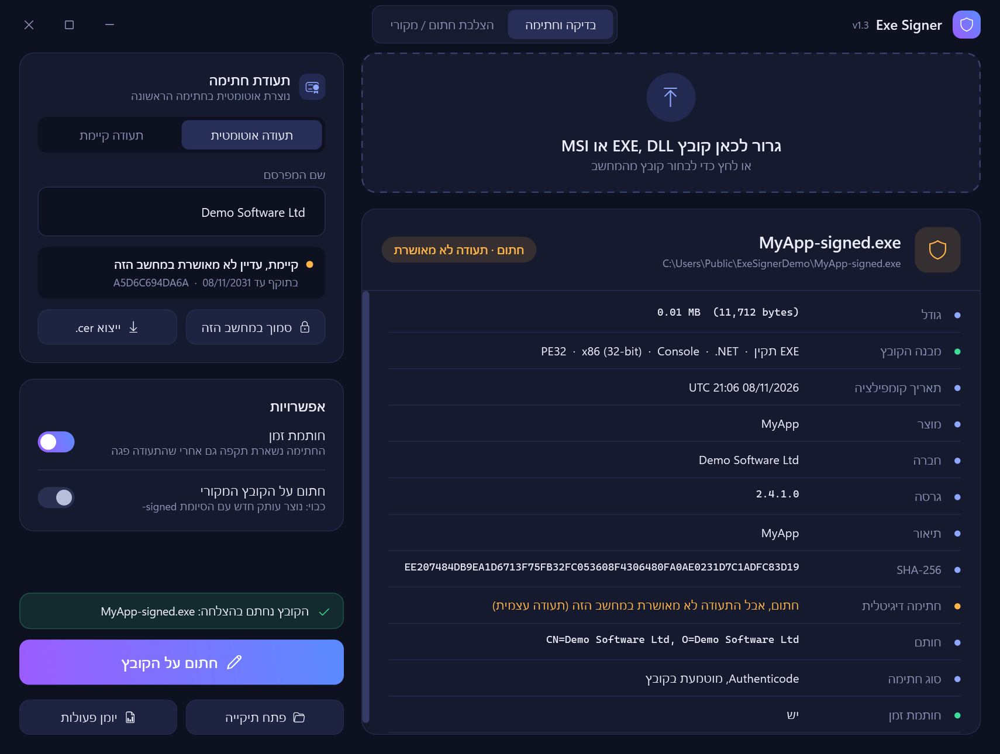
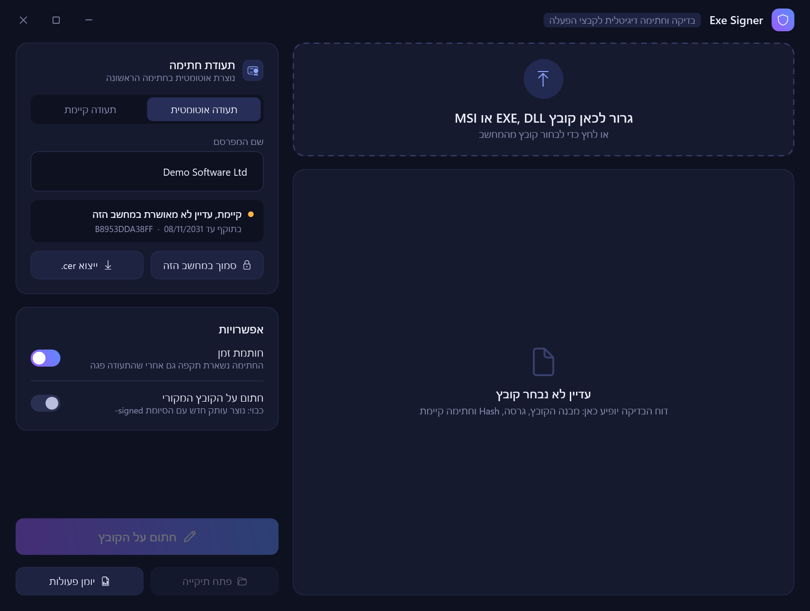
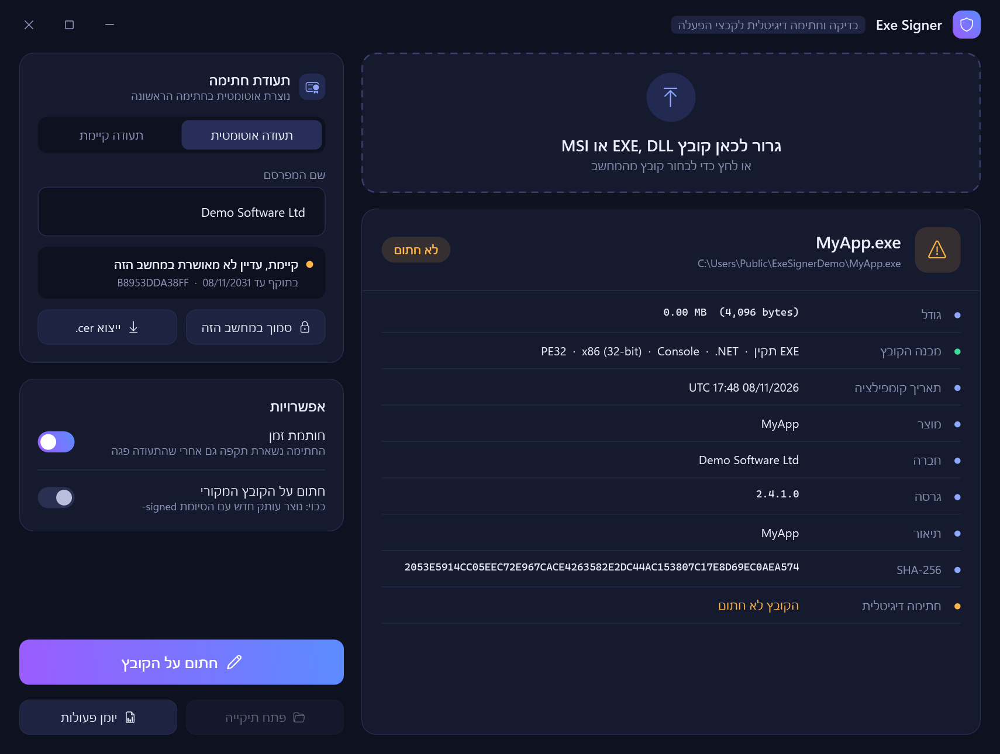

<div dir="rtl">

# Exe Signer

אפליקציית דסקטופ ל-Windows שבודקת קובצי EXE, DLL ו-MSI וחותמת עליהם בחתימה דיגיטלית (Authenticode). את תעודת החתימה היא יוצרת בעצמה.



## התקנה בפקודה אחת
פותחים PowerShell ומריצים:

</div>

```powershell
irm https://raw.githubusercontent.com/dor2500/exe-signer/main/install.ps1 | iex
```

<div dir="rtl">

הפקודה מורידה את הגרסה העדכנית ל-`%LOCALAPPDATA%\ExeSigner`, יוצרת קיצורי דרך בתפריט התחל ובשולחן העבודה ופותחת את האפליקציה. כדי לעדכן מריצים אותה שוב.

הסרה:

</div>

```powershell
& ([scriptblock]::Create((irm https://raw.githubusercontent.com/dor2500/exe-signer/main/install.ps1))) -Uninstall
```

<div dir="rtl">

## הפעלה בלי התקנה
- לחיצה כפולה על `ExeSigner.cmd`
- או גרירה של קובץ EXE על `ExeSigner.cmd`

האפליקציה רצה על PowerShell ו-WPF שמגיעים עם Windows 10 ו-11.

## מה היא עושה

| | |
|---|---|
| **בדיקה** | מבנה PE (32/64 ביט, GUI/Console, ‎.NET), גודל, SHA-256, מוצר, חברה וגרסה, חתימה קיימת ותקינותה, חותמת זמן, והאם הקובץ הורד מהאינטרנט |
| **תעודה אוטומטית** | בחתימה הראשונה נוצרת תעודת Code Signing (RSA 3072, SHA-256, תקפה ל-5 שנים) ב-`Cert:\CurrentUser\My` |
| **חתימה** | נוצר עותק `שם-signed.exe` עם חותמת זמן (DigiCert, ואם הוא לא זמין Sectigo או GlobalSign). הקובץ המקורי לא משתנה, אלא אם בוחרים לחתום עליו |
| **אמון מקומי** | "סמוך במחשב הזה" מוסיף את התעודה ל-Root ול-TrustedPublisher של המשתמש. Windows מבקש אישור |
| **ייצוא** | קובץ `.cer` להתקנה במחשבים אחרים |

<p>
  
  
</p>

## מגבלה חשובה
תעודה עצמית **לא** מעלימה את אזהרת SmartScreen או "Unknown publisher" אצל משתמשים אחרים, אלא רק במחשבים שהתקינו את קובץ ה-`.cer`.
כדי שהקובץ יהיה מהימן אצל כולם צריך תעודה מגורם מוכר (Azure Trusted Signing, או תעודת OV/EV מ-Sectigo, DigiCert או SSL.com).

## קבצים
- `ExeSigner.cmd`: קובץ ההפעלה
- `ExeSigner.ps1`: הממשק (WPF)
- `SignerCore.ps1`: הבדיקה, יצירת התעודה והחתימה. אפשר להשתמש בו גם בסקריפטים:

```powershell
. .\SignerCore.ps1
$cert = Get-OrCreateSignerCert 'My Company'
Invoke-SignExe -InputPath .\app.exe -OutputPath .\app-signed.exe -Cert $cert
Get-ExeReport .\app-signed.exe
```

</div>
